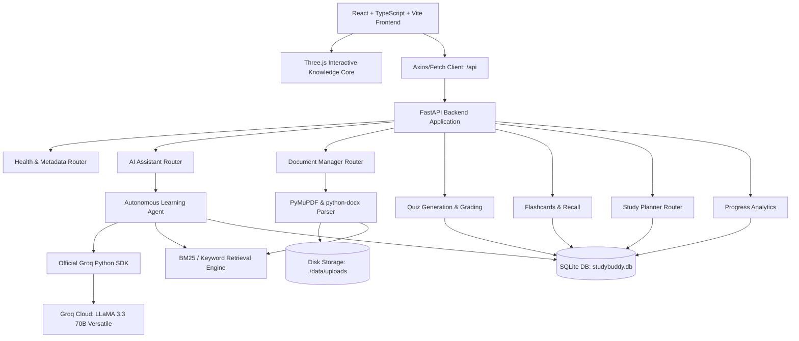

# StudyBuddy AI — System Architecture Specification

## 1. Executive Overview

**StudyBuddy AI — Intelligent AI Study Assistant** is a full-stack, autonomous educational platform engineered to transform academic study workflows through official Groq LPU™ accelerated inference, controlled agent tool execution, and grounded passage retrieval.

### Core Identity & Academic Attribution
- **Project Title:** StudyBuddy AI — Intelligent AI Study Assistant
- **Tagline:** Learn Smarter. Understand Deeper. Prepare Better.
- **Category:** AI Agent Development — Academic Mini Project
- **Authors:** Ajay Tandale & Sakshi Thombre
- **Qualification:** B.Tech Computer Science and Engineering (CSE) Students
- **Institution:** Maharashtra Institute of Technology, Chhatrapati Sambhajinagar, Maharashtra, India
- **Academic Year:** 2026–2027

---

## 2. High-Level Architecture Diagram

---

## 3. Component Breakdown

### A. Frontend Layer (React 19 + TypeScript + Vite + Tailwind CSS)
- **Cinematic Dark Design System:** Tailored HSL palette with midnight slate backgrounds (`#080C14`), charcoal surfaces (`#0F172A`), electric blue (`#38BDF8`), and violet (`#8B5CF6`) accents.
- **3D Knowledge Sphere (`KnowledgeSphereScene.tsx`):** Built with Three.js. Features an outer faceted icosahedron cage, an inner glowing cognitive core, orbiting concept particles, and mouse-reactive pointer damping. Includes an automatic fallback (`FallbackScene.tsx`) for non-WebGL devices or users with `prefers-reduced-motion`.
- **Pages & Modules:**
  1. **Landing Page:** Hero with 3D sphere, 4 core pillars, how-it-works pipeline, student credits.
  2. **Dashboard:** Authentic KPI tiles (questions answered, quizzes completed, actual average score, cards mastered), quick tools, recent documents, activity stream.
  3. **AI Study Assistant:** Multi-turn chat with 5 study modes, real-time agent tool-call inspector, and grounded citation pills.
  4. **Document Ingestion:** Drag-and-drop file uploader, document metadata table, and live Passage Retrieval Playground.
  5. **AI Summarizer:** Executive, balanced, and detailed summaries, key concepts, definitions, and anticipated exam questions.
  6. **Practice Examination Hall:** Multiple-choice, true/false, and short-answer exams, deterministic scoring, and celebratory confetti.
  7. **Spaced Flashcards:** 3D card flip animation, memory hints, shuffle, and mastery status filters.
  8. **Study Planner:** Dynamic subject priority/difficulty allocation, daily revision blocks, and interactive completion tracking.
  9. **Progress Analytics:** Verified test score trend charts and real activity streams.
  10. **About & Settings:** Student credits, Groq model status, key configuration instructions, and privacy architecture.

### B. Backend Layer (Python 3.14 + FastAPI + Pydantic v2 + SQLAlchemy)
- **Application Core (`app/main.py`):** Configures CORS middleware, lifespan startup events, SQLite initialization, and mounting `/api` sub-routers.
- **Configuration & Secrets (`app/config.py`):** Pydantic Settings reading `GROQ_API_KEY`, `GROQ_MODEL`, masked key helpers (`get_masked_groq_key()`), and safe status dictionaries.
- **Groq Integration (`app/services/groq_service.py`):** Uses official `groq.Groq` SDK, models validation (`llama-3.3-70b-versatile`), bounded exponential retries for 429/connection issues, and fails fast on 401 without infinite retry loops.
- **Document Extraction (`app/services/document_service.py`):** PyMuPDF (`fitz`) for PDF text & page numbers, `python-docx` for Word documents, semantic chunking with 150-char overlap, and sublinear BM25 scoring for passage retrieval.
- **Controlled Agent Tools (`app/tools/agent_tools.py`):** 8 strict tools validated by Pydantic argument schemas:
  1. `search_study_documents`
  2. `summarize_document`
  3. `generate_quiz`
  4. `generate_flashcards`
  5. `create_study_plan`
  6. `explain_concept`
  7. `record_quiz_result`
  8. `retrieve_learning_progress`
- **Agent Reasoning Loop (`app/services/agent_service.py`):** Bounded iterative tool-calling loop (maximum 5 turns) preventing runaway executions, collecting tool results, and providing grounded citations.
- **Quiz Grading Engine (`app/services/quiz_service.py`):** Deterministic server-side grading. Strips `correct_answer` before sending questions to clients to safeguard academic integrity.
- **Database Schema (`app/database/models.py`):** Persistent models for `documents`, `document_chunks`, `chat_sessions`, `chat_messages`, `quizzes`, `quiz_attempts`, `flashcard_decks`, `flashcard_progress`, `study_plans`, and `activity_logs`.
